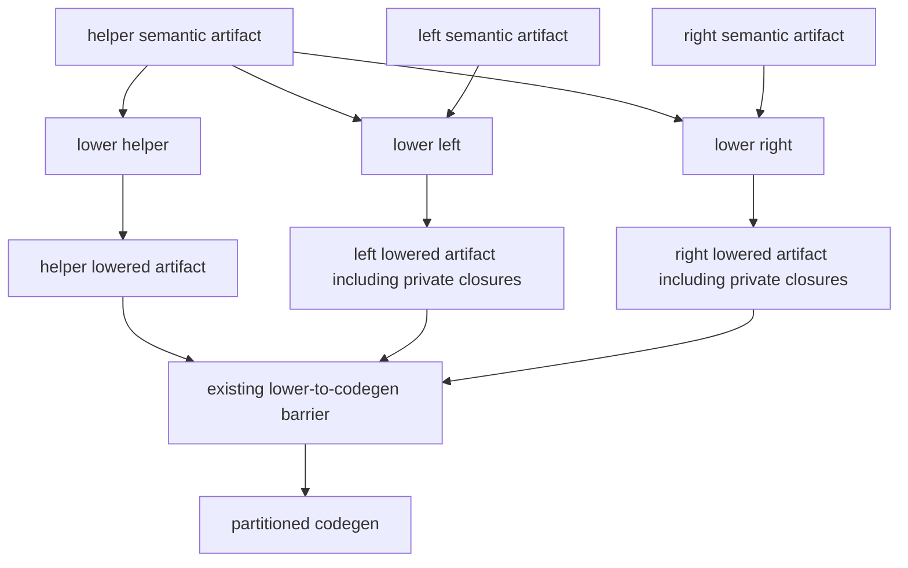

# Selective lowering for imported inline iterators

This document records the design for PR #26619 and the replacement for shared
lowering in commit `f7061ac0c`. The implementation now uses a private graph per
backend iterator expansion and restores the original per-module scheduler.
The sections below describe the reasoning and broader validation goals; they
are not a claim that every listed edge case or benchmark has been completed.

The preferred direction to prototype is to make compiler-generated closures
produced by imported iterator expansion belong to the consumer's backend
artifact. The iterator's semantic definition remains in its original module.
Lowering a consumer would then read imported definitions without modifying
backend definitions that another module must publish.

## Why the current implementations differ

Consider three modules:

```text
helper: defines an inline iterator containing a capturing closure
left:   expands that iterator inside a procedure
right:  expands the same iterator inside another procedure
```

An inline iterator has no standalone runtime body. Expansion and lambda lifting
produce environment types, hidden parameters, rewritten closure bodies, and
destructor hooks. Today, a nested routine can retain its original module-indexed
identity even though lowering an importing routine rewrites it. If `helper.t.bif`
was already published, subsequent codegen can load its pre-lift definition.

The earlier patch forced lowering of the iterator in `helper` first. That
preserved the module-level schedule but required a capture scan to avoid
rejecting unused iterators that classic compilation accepts.

The shared-lowering commit waits until all consumers have lowered before
publishing any module. This resolves that ordering problem using one symbol
graph, but every live semantic artifact becomes an input to the shared rule.
It sacrifices lowering parallelism and selective invalidation even for programs
without the problematic pattern.

The essential requirement is consistent ownership of the generated artifacts.
A whole-program lowering phase is one way to meet it, not a proven necessity.

## Proposed ownership rule

Keep source definitions and generated implementations distinct:

| Entity | Proposed owner |
| --- | --- |
| Original iterator and its semantic body | Defining module |
| Imported globals, ordinary routines, and user-defined types | Their existing owners |
| Private routine copies needed for an iterator expansion | Consuming backend module |
| Environment types, hidden parameters, and generated hooks for those copies | The same consuming backend module |
| Source locations and diagnostic provenance | Original source locations |

`left` and `right` can have separate private implementations derived from the
same iterator. Neither process writes `helper.t.bif`, and neither expects its
private environment to be reconstructed by another process.

This ownership rule is a hypothesis to validate against Nim's semantics.
Cloning must not accidentally duplicate shared storage or change observable
routine/type identity. In particular, references to globals and explicit shared
types must remain references to the original entities. Closure equality,
address-taking, static locals, recursive nested routines, and generic instances
need explicit investigation before deciding how broadly copies may be shared.

## How lowering a consumer would work

1. Load the consumer's semantic artifact and demand-load imported semantic
   bodies as needed. An exported iterator that is never expanded remains
   untouched, with no speculative capture validation.
2. On expansion, create a private working graph for the iterator implementation
   before transformations can mutate the canonical imported graph. This graph
   must include nested routine bodies, their mutable signatures, parameters,
   results, and local symbols that transformation will rewrite.
3. Establish an old-to-new symbol mapping before recursively copying bodies.
   That permits recursive and mutually referring nested routines. Rewrite
   internal references through the mapping while retaining external references
   to their original definitions. A shallow AST copy is insufficient because
   its symbol and type references still alias the original graph.
4. Run normal expansion, lambda lifting, and destructor injection on the private
   graph. Capture errors arise here, at actual use, through the existing
   validation path.
5. Collect every generated routine, environment type, and hook reachable from
   the lowered consumer. Serialize that complete graph in the consumer's
   artifact with an unambiguous backend owner.
6. Have codegen consume the serialized lowered graph. It must neither replace
   private routines with same-origin definitions from `helper.t.bif` nor repeat
   lambda lifting or destructor injection on already lowered bodies.

The copy/cache granularity is deliberately unresolved. One private template per
iterator instantiation per consumer may avoid unnecessary copying, but expansion
sites still need distinct runtime state. One copy per expansion site is simpler
to reason about initially but can increase generated code and affect identity.
The prototype must settle this using semantics and tests, not just convenience.

Top-level expansion needs the same ownership contract as expansion inside a
procedure. If it remains in `cg`, that stage must publish a complete private
implementation through the existing codegen artifacts. Alternatively, it could
move into lowering with explicit once-only handling of module initialization
and destructors. Fixing only procedure bodies would leave a pipeline gap.

## Scheduling and invalidation

With consumer-owned generated implementations, the intended schedule is:



There is no lowering-to-lowering edge from `left` to `helper`: `left` needs
`helper`'s semantic body, not a closure implementation that `helper` must lower
on its behalf. The lowering jobs can run concurrently after their semantic
inputs are available. Existing frontend ordering requirements still apply.

Restore per-module lowering rules and track the imported bodies each rule
actually reads. The existing `.bodydeps` mechanism is a starting point: it
already records module-level body dependencies. It is not necessary to add
per-routine hashes for an initial implementation.

| Edit | Intended lowering work |
| --- | --- |
| Change only a procedure in `left` | Lower `left`; reuse unrelated modules |
| Change the iterator body in `helper` | Lower `helper` and consumers that read its body |
| First introduce an iterator use in `left` | Lower `left` because its semantic artifact changed; discover the new dependency |
| Remove the last use in `left` | Lower `left`; replace its dependency manifest and remove obsolete generated definitions |
| Edit a module unrelated to the iterator | Follow ordinary module/body dependencies |
| No change | Reuse existing lowering outputs |

These are intended lowering boundaries, not promises that later link or merge
stages do no work. Module-level dependency tracking also means an unrelated
body edit within `helper` may invalidate its recorded consumers.

Dependency discovery needs a correctness audit. A cached dependency list must
not hide a newly read transitive body when an existing dependency changes.
The scheduler must ensure semantic producers are complete before a lowering
job reads a newly discovered body, either through existing phase ordering or
through dependency discovery and rescheduling. Missing manifests must trigger
safe rebuilding. This cannot be justified solely by the previous build's list.

## Changes in the existing code

| Location | Design work |
| --- | --- |
| `compiler/transf.nim`: `transformBody`, iterator expansion | Introduce private ownership before mutation; avoid caching consumer-specific transformations on canonical imported symbols |
| `compiler/transf.nim`: `introduceNewLocalVars`, `copyRoutineTypeHeader` | Assess and reuse existing copying machinery; it is not proof that the full reachable graph is isolated |
| `compiler/nifbackend.nim`: `setNestedClosureBodies`, lowering stage | Collect and lower private definitions/hooks once; restore independent module lowering and publication |
| `compiler/ast2nif.nim`: backend-local symbols, `writeLoweredModule` | Serialize private graphs with consistent names, definitions, references, and loadable signatures |
| `compiler/cgen.nim`: `nifBodyLoaded` handling | Preserve the distinction between a fully lowered loaded body and a locally transformed body still needing destructor injection |
| `compiler/deps.nim`: backend rules and `.bodydeps` | Restore per-module rules and validate discovery, invalidation, and removal of dependencies |
| Backend ownership merge and emit | Ensure private implementations and hooks are emitted by their actual consumer owner, without dropped definitions or duplicate external symbols |

The existing backend-local `@bk` representation is a useful building block,
not a complete solution. Merely changing a symbol's ID or owner after lowering
would leave cached mappings, signatures, or type references inconsistent.
Names must remain unique and stable enough across serialization, warm builds,
and changes in worker scheduling to preserve correct linking and cache reuse.
A format-version bump would be required if the artifact contract changes.

## A possible middle ground: selective shared lowering groups

An alternative is to retain shared graphs, but only for groups of modules whose
lowering can mutate each other's owned definitions. Lower each group together,
publish after every member finishes, and run independent groups in parallel.

This requires a discovery phase that identifies cross-module transformation
effects, not just imports or ordinary calls. Conservatively grouping every
import would commonly collapse back into whole-program lowering. Grouping only
previously observed uses is unsafe when new uses appear.

Group formation also needs stable cache keys and safe handling when groups merge
or split. A popular iterator provider could connect many otherwise independent
consumers, making the group large. Cycles in a directed dependency graph are not
the only concern: even an acyclic consumer-to-provider relationship can mutate
the provider's definitions, so computing import SCCs alone is insufficient.

This may be a useful intermediate design if ownership isolation proves too
invasive. It does not come for free from the existing import graph, and its
performance benefit would need measurement.

## Prototype and acceptance criteria

Start with one imported iterator, one nested capturing closure, and one consumer
procedure. Isolate its working graph, serialize the complete generated graph in
the consumer, and demonstrate that independently lowered `helper` remains
unchanged. Then add a second independently lowered consumer and verify that
each closure uses the matching environment and destructor implementation.

Only after that works should the prototype restore selective build rules and
expand coverage to generic and named nested routines, recursion, wrappers,
top-level uses, escaping closures, multiple yields, and multiple expansion sites.

Acceptance requires both behavioral and build-system evidence:

- Compare execution and diagnostics with classic compilation, including unused
  invalid captures, newly introduced uses, failed builds, and recovery.
- Test ORC/ARC destructor behavior and exceptions; reject duplicate destruction,
  missing hooks, leaks, and references to another consumer's environment.
- Exercise cold builds, warm builds, no-op builds, consumer-only edits, provider
  body edits, transitive body edits, and removal of uses.
- Vary worker count and batching; inspect emitted ownership and symbol identity,
  not only final program output.
- Check stage invocation logs to show that unrelated modules are not lowered
  after an isolated edit. A passing output comparison alone cannot prove this.
- Measure cold/warm wall time, isolated-edit latency, peak memory, and code size
  on programs both with and without the pattern. Compare the pre-PR baseline,
  earlier localized patch, shared-lowering commit, and selective prototype.

The six targeted tests passing for the shared-lowering commit are useful
regressions to retain. They do not validate this proposal or establish the
performance cost of either design.

## Recommendation

Prototype consumer-owned private implementations first. It directly addresses
the cross-module mutation that prevents independent publication, and offers a
credible route to preserving module-level parallelism and invalidation. The
hard part is complete ownership and identity handling, not the build-file edit.

If that prototype cannot preserve Nim semantics cleanly, evaluate selective
shared groups with explicit discovery and measured group sizes. In the meantime,
the earlier localized fix and the current shared-lowering implementation remain
different engineering tradeoffs for the maintainer to assess; neither proves
that selective lowering is impossible.

## Implementation evidence

The replacement restores `compiler/deps.nim` and `compiler/nifbackend.nim` to
their pre-PR scheduling/lowering implementation. The new `privateIterator` path
in `transf.nim` runs only during backend inline-iterator expansion. It copies
routine-owned symbols, copies routine signatures, and repairs signature aliases
after visiting the full graph. Named types and global storage retain their
original definitions. Source body access goes through `getBody`, preserving
body-dependency recording. Existing backend-local serialization and nested-body
collection carry the resulting implementations without a new artifact scheme.

The frontend build finishes before the backend build is scheduled in
`deps.nim`. Newly discovered body dependencies therefore read semantic artifacts
from the completed frontend run. The restored per-module `.bodydeps` rules
invalidate existing readers when a provider body changes.

A small fixture with an iterator provider, a consumer, and an unrelated module
was built with `-d:icDceCheck --parallelBuild:2`. Its `[icLower]` stage records
showed 29 lowered modules on a cold build, zero on a warm no-op build, one after
a consumer-only body edit, and two (provider and consumer) after a provider-body
edit. The unrelated module was reused. This demonstrates selective scheduling
on that fixture; it is not a representative performance benchmark.

Regression coverage includes the original three iterator metamorphic tests,
plus a private-graph test combining generic iterators, wrappers, recursive named
routines, capturing lambdas, multiple yields, escaping closures, multiple
consumers, top-level expansion, global storage, and static local storage.
The private-graph and destructor-fidelity tests were also checked with ARC.
The private-graph test additionally passes with `--parallelBuild:1` and
`-d:icBatchSize:2`.
Classic compilation supplies the output/diagnostic reference for metamorphic
tests. IC initialization order and closure-iterator instantiation are checked
separately. Broader performance, memory, code-size, and low-level routine-address
identity investigations remain follow-up work.

The experimental `-d:icBatchSize:0` configuration fails to link even a standalone
`echo 1` program, with an undefined `addFloatRoundtrip_i1544036036` reference.
This was reproduced with both the new compiler and a comparison compiler using
the pre-PR transformation, scheduler, and lowering sources from `7ae6c5e60`.
It prevents claiming a passing fully batched run; it is independent of iterator
closure expansion. Ordinary per-module runs remain the primary validation path.
